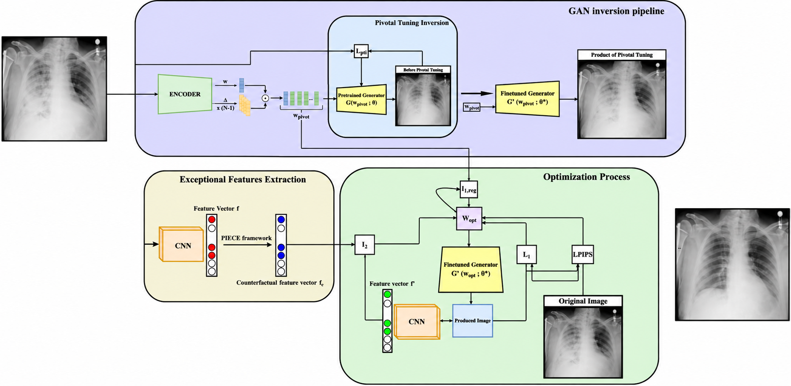
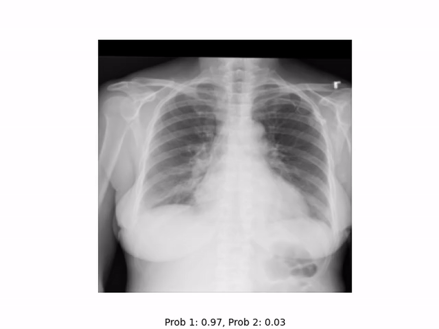
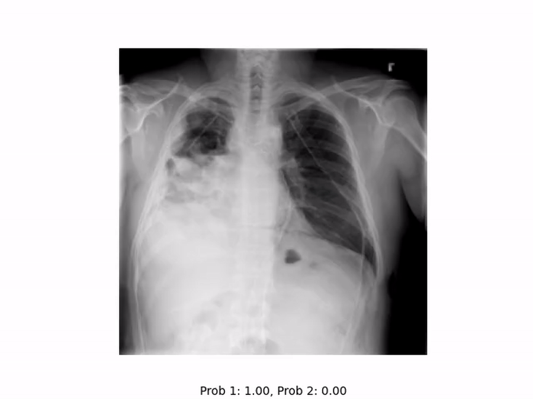
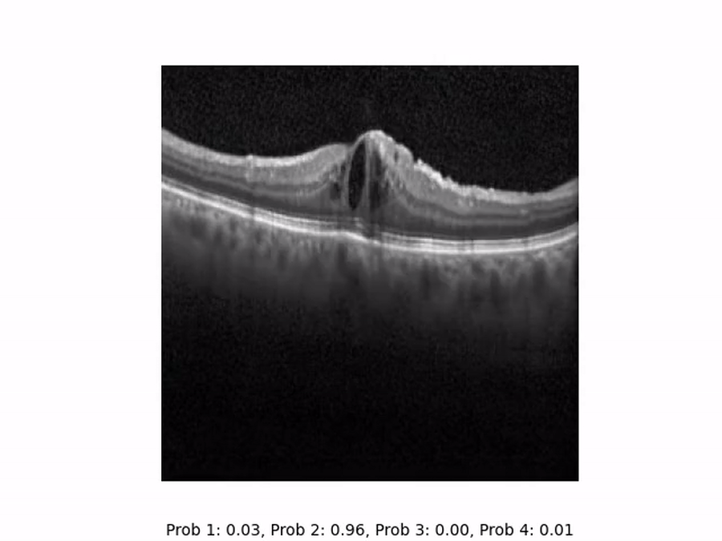
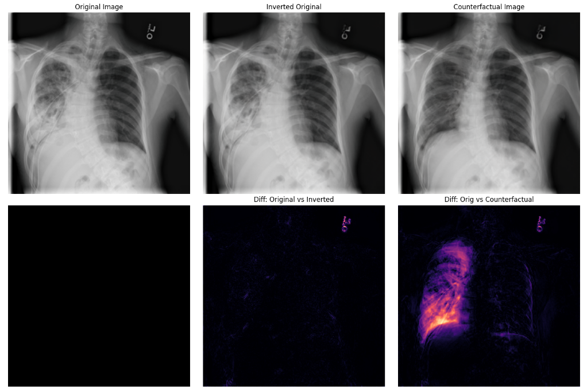
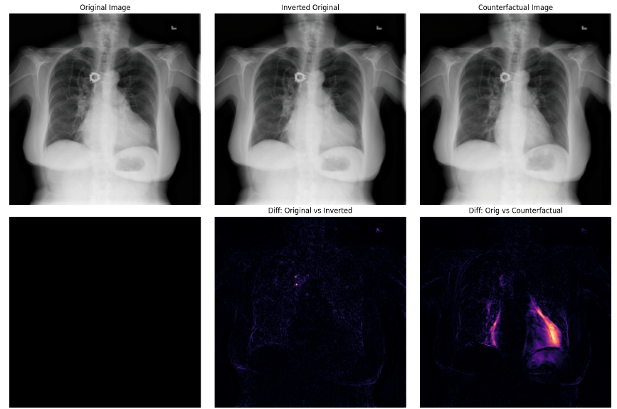
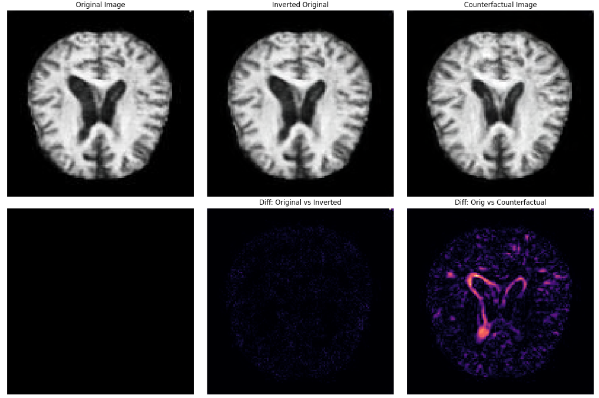
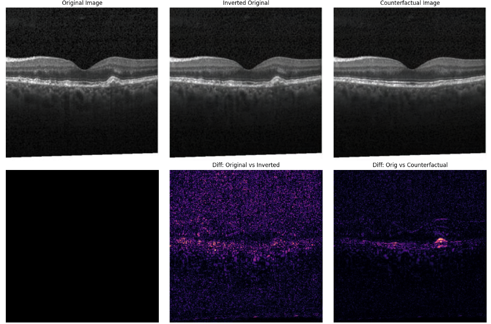

# SPRUCE: SParse Realistic Uncoupled Counterfactual Explanations in Medical Imaging

Official PyTorch repository for:

**SPRUCE: SParse Realistic Uncoupled Counterfactual Explanations in Medical Imaging**  
Ioannis Litsos, Jason Liartis, Paraskevi-Antonia Theofilou, Nikolaos Spanos, Paraskevi Tzouveli, Athanasios Voulodimos  
**SETN 2026**

> SPRUCE is a framework for generating **realistic, sparse, and classifier-guided counterfactual explanations** for medical images, while **uncoupling the training of the counterfactual explainer from the classifier under inspection**.

---

## Overview

Counterfactual explanations answer a simple but important question:

> **What is the smallest realistic change to an input image that would alter a model's prediction?**

In medical imaging, these explanations should not only change the classifier's decision, but should also preserve patient-specific characteristics and introduce modifications that are:

- **realistic**
- **clinically meaningful**
- **perceptually coherent**
- **localized to relevant regions**
- **sparse**

SPRUCE addresses these requirements through a combination of:

1. **Exceptional feature extraction** inspired by PIECE
2. **GAN inversion** using E4E
3. **Pivotal Tuning Inversion (PTI)** for high-fidelity image reconstruction
4. **Latent-space optimization** with a custom objective that balances feature alignment, perceptual similarity, and sparsity

The framework is designed so that the generative model can be trained independently from the classifier, allowing the same generator to be reused for different classifiers trained on the same imaging domain.

---

## Framework

<p align="center">
  
</p>

<p align="center">
  <em>
    SPRUCE combines GAN inversion, exceptional feature extraction, and latent-space optimization to generate sparse and realistic counterfactual explanations.
  </em>
</p>

The pipeline consists of three main stages:

### 1. GAN Inversion

The original image is projected into the latent space of a pretrained StyleGAN2-ADA generator.

- **E4E** provides an initial editable latent representation in the extended latent space \(W+\).
- **PTI** fine-tunes the generator around the query image while keeping the pivot latent fixed.

This stage produces:

- a **pivot latent vector**
- a **fine-tuned generator**

Both are required for the subsequent counterfactual optimization stage.

### 2. Exceptional Feature Extraction

A frozen classifier is used to extract the penultimate-layer representation of the input image.

Following the PIECE methodology, SPRUCE identifies features that are statistically exceptional with respect to the desired counterfactual class and selectively replaces detrimental exceptional features with values expected under the target class distribution.

This produces a **counterfactual feature vector** that guides image generation toward the desired prediction.

### 3. Counterfactual Latent Optimization

Starting from the pivot latent vector, SPRUCE optimizes a new latent representation using the fine-tuned generator.

The objective combines:

- **feature alignment loss**
- **LPIPS perceptual similarity loss**
- **latent-space L1 regularization**
- **image-space L1 regularization**

The resulting image aims to alter the classifier's decision while remaining visually close to the original image and introducing only sparse, meaningful modifications.

---

## Key Contributions

- **Sparse medical counterfactual generation**  
  SPRUCE explicitly encourages localized modifications and discourages unnecessary image changes.

- **High-fidelity image reconstruction**  
  StyleGAN2-ADA, E4E, and PTI are combined to preserve both reconstruction quality and editability.

- **Uncoupled explainer and classifier training**  
  The generative model does not need to be retrained for each classifier.

- **PIECE-based feature targeting**  
  Counterfactual generation is guided through statistically exceptional classifier features rather than direct supervision of the generator.

- **Support for binary and multi-class problems**  
  The framework can construct target-class counterfactuals for different classification settings.

- **Classifier robustness analysis**  
  The experiments show that adversarially robust classifiers tend to yield more semantically meaningful and realistic counterfactual edits.

---

## Counterfactual Transitions

SPRUCE optimizes the latent representation gradually from the inverted original image toward the final counterfactual.

Intermediate points along this trajectory can be interpreted as **semifactuals**, illustrating how the classifier's prediction changes as increasingly meaningful modifications are introduced.

### Cardiomegaly → Normal

<p align="center">
  
</p>

### Lung Opacity → Normal

<p align="center">
  
</p>

### Retinal OCT

<p align="center">
  
</p>

> These animations visualize the gradual transition from the original image to the final counterfactual. The intermediate frames correspond to semifactuals, allowing the reader to inspect how the classifier-guided latent optimization progressively modifies the image.

---

## Qualitative Results

SPRUCE was evaluated across several medical imaging modalities.

### Lung Opacity — Chest X-ray

<p align="center">
  
</p>

### Cardiomegaly — Chest X-ray

<p align="center">
  
</p>

### Brain MRI — Dementia

<p align="center">
  
</p>

### Retinal OCT

<p align="center">
  
</p>

The difference heatmaps visualize where SPRUCE modifies the original image and help assess the sparsity and semantic localization of the generated explanation.

---

## Datasets

The experiments presented in the paper use four medical imaging settings.

| Dataset | Task | Resolution |
|---|---|---:|
| RSNA Pneumonia | Healthy vs Lung Opacity | 256 × 256 |
| RSNA + NIH Chest X-ray | Healthy vs Cardiomegaly | 256 × 256 |
| Retinal OCT | Normal / CNV / DME / Drusen | 256 × 256 |
| Brain MRI Dementia | No / Very Mild / Mild / Moderate Impairment | 128 × 128 |

---

## Selected Quantitative Results

### GAN Inversion

The inversion pipeline is evaluated using distributional, pixel-level, and perceptual similarity metrics.

| Inverted Image Class | FID ↓ | CMMD ↓ | MSE ↓ | LPIPS ↓ |
|---|---:|---:|---:|---:|
| Cardiomegaly — Chest X-rays | 19.76 | 0.056 | 6.28e-4 | 0.0135 |
| Lung Opacity — Chest X-rays | 21.91 | 0.061 | 8.57e-4 | 0.0150 |
| OCT — Drusen | 26.27 | 1.031 | 5.02e-3 | 0.00712 |
| OCT — DME | 34.52 | 0.836 | 5.56e-3 | 0.00713 |
| OCT — CNV | 33.77 | 0.855 | 6.04e-3 | 0.007562 |
| Moderate Dementia — Brain MRI | 10.18 | 0.580 | 1.44e-3 | 0.0086 |

Lower values indicate better performance.

### Effect of Classifier Robustness

The following results show the effect of the adversarial perturbation bound used during TRADES training on Lung Opacity counterfactual generation.

| TRADES ε | FID ↓ | CMMD ↓ | Flip Ratio ↑ | L1 ↓ | Confidence ↑ |
|---|---:|---:|---:|---:|---:|
| 0 | 60.22 | 0.350 | 100% | 0.0118 | 0.8601 |
| 1/255 | 56.34 | 0.315 | 100% | 0.0168 | 0.9866 |
| 2/255 | 58.11 | 0.326 | 100% | 0.0184 | 0.9958 |
| 8/255 | **49.63** | **0.264** | 98% | 0.0269 | 0.9744 |

An important observation of the study is that increased classifier robustness often produces more realistic and semantically aligned counterfactuals, although this can come at the cost of reduced sparsity.

---

## Repository Structure

```text
SPRUCE/
├── PTI/
│   └── GAN inversion using E4E and Pivotal Tuning
│
├── classifier_training/
│   └── Plain and adversarially robust classifier training
│
├── counterfactual_generation/
│   └── PIECE feature extraction and latent counterfactual optimization
│
├── assets/
│   ├── framework/
│   ├── gifs/
│   └── examples/
│
├── requirements.txt
├── LICENSE
└── README.md
```

### `PTI/`

Contains the GAN inversion pipeline used to obtain:

- the pivot latent vector
- the fine-tuned StyleGAN generator for each query image

See [`PTI/README.md`](PTI/README.md).

### `classifier_training/`

Contains the code used to train the image classifiers used in the experiments, including both naturally trained and adversarially robust variants.

See [`classifier_training/README.md`](classifier_training/README.md).

### `counterfactual_generation/`

Contains the implementation of:

- reconstruction assessment
- PIECE-based counterfactual feature vector construction
- latent optimization
- final counterfactual generation
- quantitative and qualitative evaluation

See [`counterfactual_generation/README.md`](counterfactual_generation/README.md).

---

## Installation

Clone the repository:

```bash
git clone https://github.com/johnskop7/SPRUCE.git
cd SPRUCE
```

Install the required dependencies:

```bash
pip install -r requirements.txt
```

A CUDA-capable GPU is strongly recommended for GAN inversion, Pivotal Tuning, and counterfactual latent optimization.

---

## Usage

A typical SPRUCE workflow consists of the following stages.

### Step 1 — Train or Load a Classifier

Train a plain or adversarially robust classifier using the code in:

```text
classifier_training/
```

The classifier is later used both to identify exceptional features and to guide the counterfactual optimization.

### Step 2 — Perform GAN Inversion

Use the pipeline under:

```text
PTI/
```

For every query image, the inversion stage should produce:

```text
pivot latent vector
+
fine-tuned generator weights
```

These two components are required for counterfactual generation.

### Step 3 — Construct the Counterfactual Feature Vector

Use the PIECE-based scripts under:

```text
counterfactual_generation/
```

to identify exceptional penultimate-layer classifier features and construct the target counterfactual feature representation.

### Step 4 — Generate the Counterfactual

Starting from the pivot latent vector, optimize the latent representation using the fine-tuned generator and the SPRUCE loss.

The final output includes:

- the generated counterfactual image
- the optimized latent representation
- classifier probabilities
- image difference visualizations
- evaluation metrics

---

## Pretrained Models

Pretrained model weights used in the SPRUCE experiments are hosted on Google Drive.

| Model | Dataset | Resolution | Download |
|---|---|---:|---|
| StyleGAN2-ADA | CheXpert | 256 × 256 | [Google Drive](https://drive.google.com/file/d/1aEZ0tyG06wYFUiRjk6n3cTWZ4G6fBlLP/view?usp=sharing) |
| StyleGAN2-ADA | Retinal OCT | 256 × 256 | [Google Drive](https://drive.google.com/file/d/1EsFR20QJaKfgX2SapvVglUT4K08--ABB/view?usp=sharing) |
| E4E encoder | CheXpert | 256 × 256 | [Google Drive](https://drive.google.com/file/d/1DcKFqAWZK7cwtJ7quFKj6O_NTK2HTzhY/view?usp=sharing) |
| E4E encoder | Retinal OCT | 256 × 256 | [Google Drive](https://drive.google.com/file/d/1GJeexhOtL4NsrnmK0VaBFoQ-tBn5imoU/view?usp=sharing) |
| ConvNeXt-Base | Lung Opacity - Normal | 256 × 256 | [Google Drive](https://drive.google.com/file/d/1cCa1qdYxzeRYhVjE2sgtHWcwSl8be6iE/view?usp=sharing) |
| ConvNeXt-Base + TRADES | Lung Opacity - Normal | 256 × 256 | [Google Drive](https://drive.google.com/file/d/16bq6QojvVUxrLLaf5Iai677iGucYyave/view?usp=sharing) |
| ConvNeXt-Base | Cardiomegaly - Normal | 256 × 256 | [Google Drive](https://drive.google.com/file/d/1aCqQ3f981QgpZ5PTB6Uz4YY_GtBoK9mw/view?usp=sharing) |
| ConvNeXt-Base + TRADES | Cardiomegaly - Normal | 256 × 256 | [Google Drive](https://drive.google.com/file/d/1wnTY_abIYLOGlU9HkZzNQpEKDmhs_11f/view?usp=drive_link) |

The pretrained GANs can be reused with compatible classifiers trained on the corresponding image domain.

---

## Paper

**SPRUCE: SParse Realistic Uncoupled Counterfactual Explanations in Medical Imaging**

Ioannis Litsos, Jason Liartis, Paraskevi-Antonia Theofilou, Nikolaos Spanos, Paraskevi Tzouveli, Athanasios Voulodimos

Presented at **SETN 2026**.

---

## Acknowledgements

SPRUCE builds upon several important open-source projects and research contributions, including:

- **PIECE** — exceptional-feature-based counterfactual and semifactual explanations
- **StyleGAN2-ADA** — high-quality generative modeling with adaptive discriminator augmentation
- **E4E** — editable encoder-based StyleGAN inversion
- **Pivotal Tuning Inversion (PTI)** — high-fidelity reconstruction while preserving latent editability
- **TRADES** — adversarial training for improved classifier robustness

Please refer to the original publications and repositories when using these components.

---

## License

This project is released under the **MIT License**.

See [`LICENSE`](LICENSE) for details.
